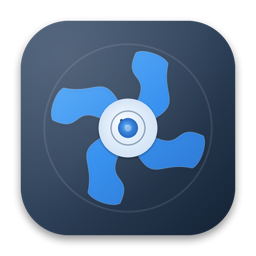

<p align="center">
  
</p>

# LOQ Fan Control

**Experimental fan monitoring and control for the Lenovo LOQ 15IAX9 on macOS (Hackintosh / OpenCore).**

A native SwiftUI app plus a small kernel extension that reads the laptop's embedded
controller (EC) and sends the same fan commands the Lenovo firmware itself uses —
with a custom fan curve, gradual ramping and multiple fail-safes. Inspired by
[Omen-Control](https://github.com/DEATHLESSEVIL/Omen-Control) (HP OMEN).

> ⚠️ **Unofficial and experimental.** This software writes to your laptop's embedded
> controller. It was developed and tested on **one machine** (LOQ 15IAX9, i5-12450HX,
> RTX 4050, macOS 15.x, OpenCore). Other models or BIOS versions may use different EC
> registers. **Use at your own risk — you are responsible for your hardware.**

## Features

- Live **CPU / GPU fan RPM**, **CPU / GPU temperature** and **power mode** in a
  gauge-style dashboard
- **Custom fan curve** (up to 12 points) — drag points on a graph, click the line to
  insert, double-click to add
- **Gradual ramping** with separate speed-up / slow-down rates and temperature smoothing
- **Fixed speed** and **Max Fan** modes
- **Menu bar item** with live readings and mode switching; keeps running when the
  window is closed
- Presets (Quiet / Balanced / Aggressive), settings saved as JSON

## Safety design

| Layer | Protection |
|---|---|
| Kext | Requests clamped to **1900–5000 RPM**; commands serialized by a lock |
| Kext | **5-second watchdog** — if commands stop arriving (crash, force quit), firmware Auto is restored |
| App | Always starts in **firmware Auto**; manual control is never resumed automatically |
| App | Gradual slew (default +100 / −40 RPM per second), temperature smoothing |
| App | **Emergency override** (default 90 °C, using the raw temperature) forces max fan quickly |
| App | Fails safe to firmware Auto if the CPU temperature becomes unreadable |
| App | Auto restored on quit and before sleep; curve validation rejects unsafe files |

## Verified vs. unverified

**Verified on real hardware** (LOQ 15IAX9, macOS 15.6): EC register reads (fan RPM,
temperature, power mode), fixed-speed and max-fan control through the earlier kext,
app build with Xcode Command Line Tools, all 27 curve-math validation checks.

**Not yet verified on hardware** ([unverified]): the hardened kext with the 5 s
watchdog (`MANU` property), the redesigned v0.3.0 UI, ramping/curve end-to-end
behavior on the new build, and the firmware power-mode setter (`WMAA`).

## Requirements

- Lenovo LOQ 15IAX9 (other Lenovo gaming laptops with the same Gamezone EC layout may
  work but are untested)
- macOS installed with OpenCore and **kext signing disabled** (kexts injected via OpenCore)
- Xcode Command Line Tools (`xcode-select --install`) — no full Xcode needed

## Build and install

### 1. Kext

```sh
cd kext
./check.sh        # verifies the command line tools can build a kext
make              # builds build/LOQFanMon.kext
```

**Back up your EFI folder first**, then copy `build/LOQFanMon.kext` to
`EFI/OC/Kexts/` and add an entry under `Kernel -> Add` in your `config.plist`:

| Key | Value |
|---|---|
| BundlePath | `LOQFanMon.kext` |
| ExecutablePath | `Contents/MacOS/LOQFanMon` |
| PlistPath | `Contents/Info.plist` |
| Arch | `x86_64` |
| Enabled | `true` |

Reboot, then check that it loaded:

```sh
kmutil showloaded | grep -i loqfan
ioreg -l -w0 -c LOQFanMon | grep -E "FA1S|FA2S|MANU"
```

### 2. App

```sh
cd app
./build-app.sh
open "LOQ Fan Control.app"
```

Your curve and ramp settings are saved to
`~/Library/Application Support/FanBar/curve.json`.

## Testing the watchdog (recommended before trusting manual control)

Set a fixed speed in the app, then force-quit it. Within about 5 seconds `MANU` in the
`ioreg` output above should return to `0` and the fans should go back to the firmware's
control.

## How it works

The kext maps the EC's memory window at physical `0xFE0B0000` and polls fan speeds once
a second; fan commands go through the same EC handshake the firmware's own `ERCD` ACPI
method uses. The interface between kext and app is IORegistry properties
(`FA1S FA2S FANR EFAN PMOD CTMP FFON MANU` in; `SetCPUFanRPM`, `SetGPUFanRPM`,
`SetMaxFan` out). Full register tables and offsets:
[docs/HOW-IT-WORKS.md](docs/HOW-IT-WORKS.md).

## Project layout

```
kext/    LOQFanMon.kext source (IOService, EC reader + command interface)
app/     SwiftUI app (dashboard, curve editor, menu bar), fan-curve engine
docs/    How-it-works (EC register tables and command interface)
```

## Known limitations

- Both fans currently receive the same RPM; the GPU fan's firmware idle (2200) is above
  the CPU fan's (1900). Separate CPU/GPU curves are planned.
- No privilege check on the kext property setter — any local process can send fan
  requests (within the clamped range).
- The kext cannot take the firmware's own ACPI mutex, so a firmware EC command issued at
  exactly the same moment could collide (expected to be rare).
- GPU temperature is unavailable while the dGPU is asleep.

## Roadmap

- [ ] Watchdog test on real hardware (see above)
- [ ] Separate CPU / GPU fan curves
- [ ] Power-mode switching (Quiet / Balanced / Performance) from the app
- [ ] Rename the settings folder (`FanBar` → `LOQFanControl`), signed release binaries

## Contributing

Issues and PRs are welcome — but hardware-specific register values are model-specific;
check `docs/HOW-IT-WORKS.md` first.

## Credits

- Inspired by [Omen-Control](https://github.com/DEATHLESSEVIL/Omen-Control)
- Fan units and behavior cross-checked against Lenovo's firmware tables (DSDT/SSDT3)
  and [LenovoLegionToolkit](https://github.com/BartoszCichecki/LenovoLegionToolkit)
  readings on Windows

## License

MIT — see [LICENSE](LICENSE).
